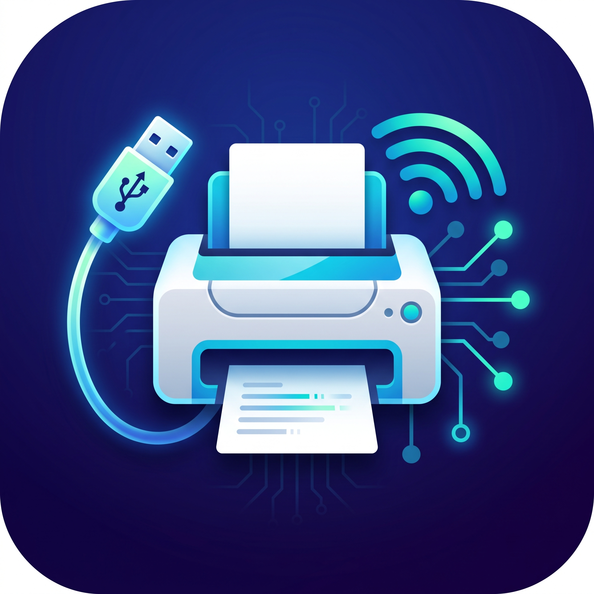

# Open Printer Proxy



Turn an Android device into a USB printer bridge: print through Android's print framework, or share the connected printer with other devices on your local network over IPP.

## Please read this first

**This is a personal project, built for my own purposes, and it is vibe coded.** It was developed with AI assistance to solve a specific printing need. It works for my setup, but **the quality, correctness, security, and maintainability of the code cannot be guaranteed**. Treat it as an experiment, not a production-ready or professionally audited printing solution.

**The Brother DCP-1510 is the only printer that has actually been used to test this project.** Other printers may work, but they have not been tested. The presence of a printer language or driver in the code is not a compatibility guarantee.

Use it at your own risk. There is no promise of ongoing maintenance, support, or compatibility with your hardware.

## What it does

- Makes a connected USB printer available to apps that use Android's system print dialog.
- Optionally shares the printer over IPP, with DNS-SD/mDNS advertisements so other devices on the local network can discover it.
- Provides per-printer settings for printer language, paper size, resolution, margins, and network sharing.
- Handles print-job progress notifications and cancellation.

The implementation includes PDF passthrough, monochrome PCL raster output, and Brother laser/GDI output based on brlaser. Only the Brother DCP-1510 has been tested; these output formats should not be read as a list of verified compatible printers.

## Requirements

- An Android device running Android 7.0 (API 24) or later, with USB host/OTG support.
- A USB printer and a suitable USB cable or OTG adapter.
- For network sharing, a local Wi-Fi or Ethernet network reachable by the devices that will print.

The Android device must remain connected to the printer for printing and network sharing to work.

## Using the app

1. Build and install the app using the instructions below.
2. Connect the printer to the Android device. Accept Android's prompt to let Open Printer Proxy access the USB device.
3. Enable Open Printer Proxy in Android's system printing settings. The location and wording of this setting vary by device.
4. Open a document in an app that supports printing, choose **Print**, and select the USB printer.
5. Open Open Printer Proxy to adjust the settings of printers it has discovered.

Allow notifications if you want to see print-job progress. On Android 17 and later, the app also requests local network access; network sharing stays paused if that permission is denied. Local USB printing does not require local network access.

### Sharing on the local network

Enable **Share on the network** in the printer's settings. Sharing runs as a foreground service while a shared printer is connected and USB access is granted. On Android 17 and later, local network permission must also be granted.

Other devices can discover the advertised IPP printer. If automatic discovery does not work, the printer's settings show an IPP address that can be added manually. The server uses port **8631**.

**Network printing has no authentication: anyone on the permitted local network can submit print jobs.** Use sharing only on a network you trust, and do not expose the service to the internet. This personal, vibe-coded project should not be relied upon as a secure print server.

## Building and installing

Clone the repository:

```sh
git clone git@github.com:ArnyminerZ/OpenPrinterProxy.git
cd OpenPrinterProxy
```

Open the project in Android Studio, or use the checked-in Gradle wrapper. The project currently uses compile/target SDK 37, Gradle 9.7.1, and Android Gradle Plugin 9.4.1. The Gradle daemon toolchain requests JDK 25; Java source/target compatibility is 11.

Install Android SDK platform 37 and configure your SDK location through Android Studio or a local `local.properties` file. Initial builds need network access to download dependencies and, if necessary, the configured JDK toolchain.

```sh
./gradlew :app:assembleDebug
```

The debug APK is written to `app/build/outputs/apk/debug/app-debug.apk`. With ADB configured and a device connected:

```sh
adb devices
adb install -r -t app/build/outputs/apk/debug/app-debug.apk
```

If multiple devices are connected, add `-s DEVICE_SERIAL` to the ADB install command. On Windows, use `gradlew.bat` in place of `./gradlew`.

### Release APKs

Publishing a GitHub release (including a prerelease) runs the release workflow, which builds the tagged source and attaches `OpenPrinterProxy-unsigned.apk` to that release. Draft releases do not trigger a build. No signing secrets are needed.

The release APK is unsigned and must be signed before it can be installed on Android. For a directly installable development build, use the debug build instructions above.

### Checks

```sh
./gradlew :app:testDebugUnitTest :app:lintDebug
```

The unit tests cover IPP message encoding/decoding and Brother line encoding. Passing tests does not establish compatibility with other printers or guarantee overall code quality.

### Launcher artwork

The launcher icons are derived from `logo.jpeg`. With ImageMagick installed, regenerate them using:

```sh
bash scripts/generate-launcher-icons.sh
```

Themed launchers use a separate monochrome printer vector.

## License and acknowledgements

Licensed under **GPL-2.0-or-later**, without warranty. See [LICENSE](LICENSE) and [NOTICE](NOTICE).

The Brother laser writer and its encoder tests are ported from [brlaser](https://github.com/pdewacht/brlaser), Copyright 2013 Peter De Wachter, also licensed under GPL-2.0-or-later.
